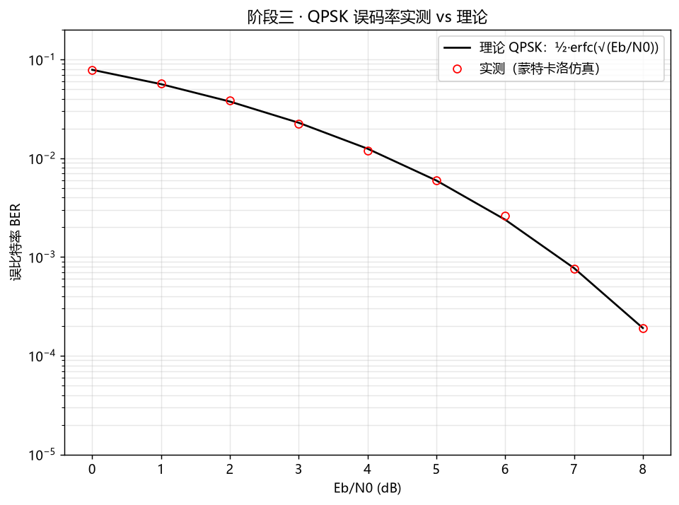
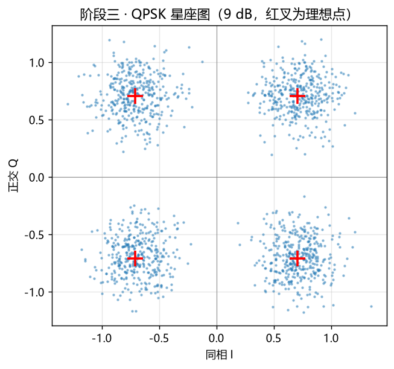
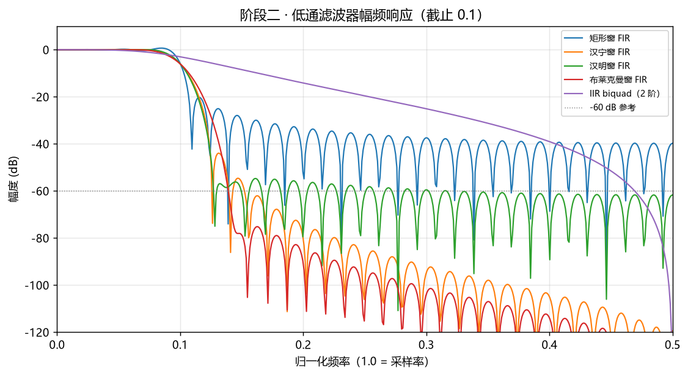
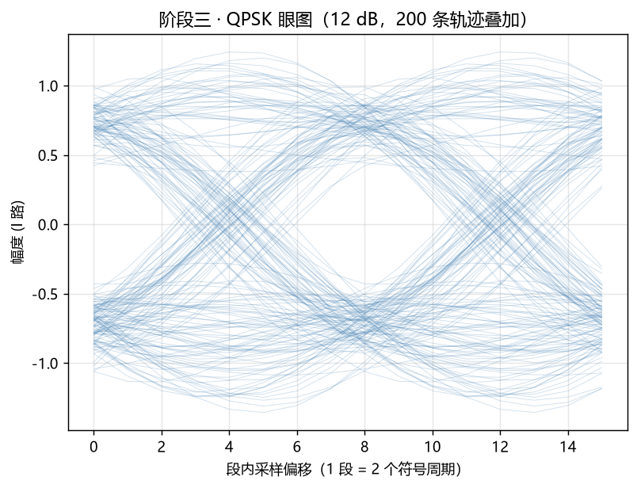

# C++ 数字信号处理实验库

> 项目时间：2026.09 – 2026.10 · 个人练习项目

使用 C++17 从零实现数字信号处理的核心算法，不依赖任何第三方数学库。三个阶段依次是：

1. **FFT**：朴素 DFT（作为基准真值）+ 基 2 Cooley-Tukey FFT（迭代 DIT 与递归 DIF 两条独立路径）+ 性能对比；
2. **FIR / IIR 滤波**：窗函数法设计线性相位 FIR、二阶 IIR 节、频谱泄漏演示；
3. **QPSK 调制解调全链路**：格雷映射、根升余弦成形、AWGN 信道、匹配滤波与定时抽样，实测误码率并与理论曲线对照。

## 目录结构

```
cpp-dsp-lab/
├── CMakeLists.txt
├── include/dsp/            # 公共头文件
│   ├── fft.h               # DFT / FFT / IFFT / 位反转
│   ├── window.h            # 矩形 / 汉宁 / 汉明 / 布莱克曼窗
│   ├── filter.h            # FIR 设计与卷积、IIR 双二阶
│   ├── qpsk.h              # QPSK 映射、RRC、AWGN、BER
│   ├── csv.h               # CSV 输出
│   └── console.h           # Windows 控制台 UTF-8
├── src/                    # 实现
├── apps/                   # 三个演示程序
│   ├── fft_demo.cpp
│   ├── filter_demo.cpp
│   └── qpsk_demo.cpp
├── tests/test_all.cpp      # 32 个用例 / 25059 条断言
├── tools/plot.py           # 可选的绘图脚本（不参与编译）
├── docs/design.md          # 设计说明与实测结果
└── docs/figures/           # 实测结果图
```

## 构建与运行

需要 C++17 编译器与 CMake 3.16 以上，Windows 下验证使用的是 Qt 附带的 MinGW g++ 13.1：

```bash
cmake -G "MinGW Makefiles" -S . -B build
cmake --build build -j
```

演示程序会把 CSV 写到当前目录下的 `output/`，因此请在仓库根目录运行：

```bash
./build/fft_demo.exe        # FFT 误差、加速比实测
./build/filter_demo.exe     # 窗函数旁瓣、滤波效果、频谱泄漏
./build/qpsk_demo.exe       # QPSK 全链路、BER 实测 vs 理论
```

可选：安装 numpy 与 matplotlib 后运行 `python tools/plot.py` 把 CSV 画成图。

## 测试

```bash
./build/tests.exe
```

```
[doctest] test cases:    32 |    32 passed | 0 failed
[doctest] assertions: 25059 | 25059 passed | 0 failed
```

测试覆盖了算法正确性（与朴素 DFT 对照、DIT/DIF 双路径互证、Parseval / 时移 / 线性 / 共轭对称等解析性质）、滤波器指标、QPSK 映射与误码率，以及非 2 的幂长度等异常处理。

## 实测结果

### FFT 加速比（朴素 DFT vs 基 2 FFT）

| N | DFT (ms) | FFT (ms) | 加速比 |
|---|---|---|---|
| 256 | 2.640 | 0.0383 | 68.9× |
| 1024 | 43.464 | 0.2061 | 210.9× |
| 4096 | 702.919 | 1.0323 | 680.9× |
| 8192 | 2817.262 | 2.2861 | 1232.3× |

与 N/log₂N 的理论量级一致；具体数值随机器波动，仓库中的 `output/fft_bench.csv` 是最近一次实测数据。

### 窗函数对 FIR 旁瓣的影响

| 窗 | 第一旁瓣 |
|---|---|
| 矩形 | -20.9 dB |
| 汉宁 | -44.0 dB |
| 汉明 | -56.9 dB |
| 布莱克曼 | -78.0 dB |

### QPSK 误码率（每点 20 万比特）

| Eb/N0 (dB) | 实测 BER | 理论 BER |
|---|---|---|
| 0 | 7.84e-2 | 7.87e-2 |
| 2 | 3.83e-2 | 3.75e-2 |
| 4 | 1.20e-2 | 1.25e-2 |
| 6 | 2.63e-3 | 2.39e-3 |
| 8 | 1.90e-4 | 1.91e-4 |

无噪自检中，判决点相对理想星座点的偏差约 0.005，误比特数为 0。

## 结果图

| | |
|---|---|
|  |  |
| 误码率：实测与理论 | QPSK 星座图 |
|  |  |
| 不同窗函数设计的 FIR 频响 | 匹配滤波输出眼图 |

更多图见 `docs/design.md` 与 `docs/figures/`。
